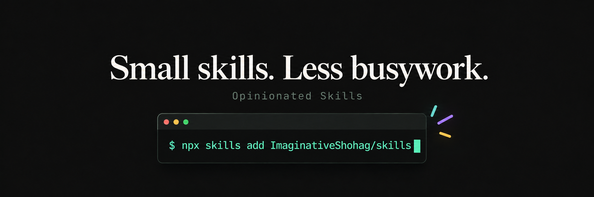

[](https://github.com/ImaginativeShohag/skills)

# Opinionated Skills

Portable custom skills for coding agents, packaged for the [Skills CLI](https://github.com/vercel-labs/skills) and [skills.sh](https://skills.sh/).

## Skills

| Skill | Purpose |
| --- | --- |
| [weekly-skills-maintenance-report](skills/weekly-skills-maintenance-report/SKILL.md) | Create a weekly, read-only schedule that reports results from an existing host maintenance job. |
| [raycast-confetti-hook](skills/raycast-confetti-hook/SKILL.md) | Check Raycast prerequisites and set up confetti hooks for Claude Code on macOS. |

## Install

From this repository's root, preview available skills without installing:

```sh
npx skills add . --list
```

Install the first skill globally for all agents supported by the CLI:

```sh
npx skills add . --skill weekly-skills-maintenance-report --global --agent '*'
```

Install from [ImaginativeShohag/skills](https://github.com/ImaginativeShohag/skills):

```sh
npx skills add ImaginativeShohag/skills --skill weekly-skills-maintenance-report --global --agent '*'
```

To install every curated skill globally for all supported agents:

```sh
npx skills add ImaginativeShohag/skills --global --all
```

Review the CLI prompts before confirming. Installation makes the instructions available; scheduling support depends on the receiving agent and must be requested separately.

## Contribute

Follow [AGENTS.md](AGENTS.md). Keep skill resources relative, use home-relative runtime paths where needed, and keep private configuration and data outside this repository.
